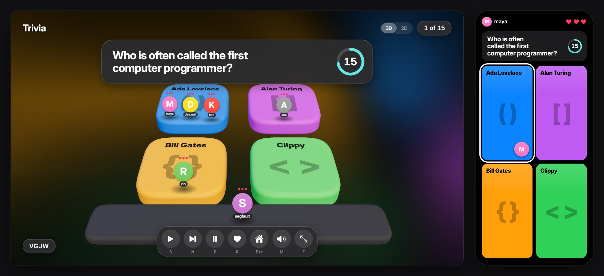

# Trivia

A live elimination trivia game for in-person events. The projector shows a 3D arena with
four answer platforms. Players join on their phones from a QR code and move their token
onto the platform they think is right before the timer runs out. Wrong platforms drop away,
and everyone standing on one loses a life. The last player with lives left wins.



It runs on Cloudflare Workers, with one Durable Object per room, and fits the free plan.
There are no accounts, no database and nothing to install on a phone.

## How a game works

- Every player starts with 3 lives. A wrong answer costs one, and so does no answer.
- If everyone still in is wrong, the floor holds and nobody loses a life.
- A game is 15 questions: 5 easy, 5 medium, 5 hard. Each runs 20 seconds, then a 6 second
  reveal. Questions come from a pack of 60 on computer science, and a room does not repeat
  one until it has asked them all.
- The game ends early when one player has lives left. Otherwise the most lives after
  question 15 wins. A tie goes to sudden death (one wrong answer and you are out) for up to
  3 more questions, and anyone still tied shares the win.
- Players who join mid-game wait for the next one. Players who run out of lives can still
  guess along, and their phone tells them whether they would have survived.
- Up to 40 players fit in a room. It is built for crowds under 30.

## Hosting

Open `/host` on the laptop that drives the projector. It creates a room and shows a QR
code. That laptop is the host: its controls are the dock along the bottom, or the keyboard.

`/host/2d` is the same room drawn flat, for a laptop that struggles with 3D. The switch in
the top corner moves between the two at any time, even mid-game.

| Key | Action |
|---|---|
| `S` | Start a game |
| `N` or Space | Skip ahead: end the question, or end the reveal |
| `P` | Pause or resume the timer |
| `R` | Revive: everyone back to full lives, late joiners included |
| `Esc` | Back to the lobby (press twice during a game) |
| `M` | Mute |
| `F` | Full screen |

In the lobby, click a name once to arm it and again to remove that player for the session.

Sound comes from the projector only, and starts with the host's first key press or click:
music in the lobby and during questions, a blip when someone joins, ticks for the last five
seconds, a rumble when platforms drop, and a sting for the winner. It is all synthesized in
the browser; there are no audio files. Phones stay silent.

The room belongs to the browser that opened it. The host key is kept in that browser's
storage and never appears in the address bar or on screen, so another device that opens the
same room code cannot run the game. A room closes itself six hours after the last device
leaves.

## Playing

Scan the QR code, or open the site and type the room code. Opened with no code, the site
shows a landing page: a short video of a round, a button to host and a field for a room
code. Pick a name and a color, then
drag your token onto an answer or just tap one. You can change your mind until the timer
runs out. If you reload or lose signal, you come back with the lives you had.

## Running it

```
npm install
npm run dev
```

Then open http://localhost:5173/host for the projector and http://localhost:5173 on a
phone. To join from real phones on the same network, run `npm run dev -- --host` and open
the projector page by the laptop's network address, so the QR code points there.

`npm run dev` runs the pages, the Worker and the Durable Object together, through
`@cloudflare/vite-plugin`.

## Tests

```
npm test                    # game rules, pack validation, and the room inside workerd
npm run test:e2e            # the full game in Playwright's own Chromium
npm run test:e2e:browsers   # the 2D game in WebKit and Firefox
npm run typecheck
```

The end-to-end tests start the dev server themselves. Set `TRIVIA_URL` to point them at
another copy, such as `vite preview` or a deployed site.

`npm run shots`, with the dev server running, saves a screenshot of every screen to
`screenshots/`.

`npm run video` remakes the landing page's video in `public/video/`. It needs ffmpeg, a
build (`npm run build`) and the dev server running. It plays one real game, then replays
what the room sent one frame at a time, so the video is smooth however slow the machine is.

## Deploying

```
npx wrangler login
npm run deploy
```

That builds the pages and deploys the Worker with its static assets. The room is a
SQLite-backed Durable Object, which the Workers free plan includes.

## Questions

A pack is a TypeScript file in `content/packs/`. Each question is one short line (90
characters at most) with four short answers (18 at most, because they are printed on the
platforms), the index of the right one, and a difficulty from 1 to 3. `npm test` checks the
lengths, the ids, the split across tiers, and that the right answer is spread evenly over
the four platforms. Add a pack to `content/packs/index.ts` to make it available.

## Layout

```
src/worker/      the Worker and the Room Durable Object
src/shared/      message types, pure game rules, timings and caps
src/client/      phone controller, projector pages, shared pieces
content/packs/   question packs
test/            rules, pack validation, room integration, end-to-end
```

The Room Durable Object is the only authority on a game: phones and projectors send intents
and render what it sends back. The right answer never leaves it before the reveal.

BRAND.md describes the look. CLAUDE.md holds the rules for working in this repo.

## Credits

Game mechanics are inspired by Bean Bash by GDG on Campus Seneca Polytechnic. No code,
assets or questions come from it.

Bundled work: three.js, React, Tailwind CSS, Framework7 Icons, qrcode-generator and Kawarp
by Better Lyrics (all MIT), and Inter (OFL). The glass button, the host dock and the glass
panels are adapted from components on 21st.dev: Apple Tahoe Liquid Glass Button by Hossain
Jahed, Mac Style Floating Dock by @themeocean and Glass Card by @educalvolpz, all MIT.

Trivia is styled after Apple's design language. It is not affiliated with Apple and uses
none of Apple's logos, fonts or icons.

## License

AGPL-3.0-only. See [LICENSE](LICENSE). If you host a modified copy, share its source.
